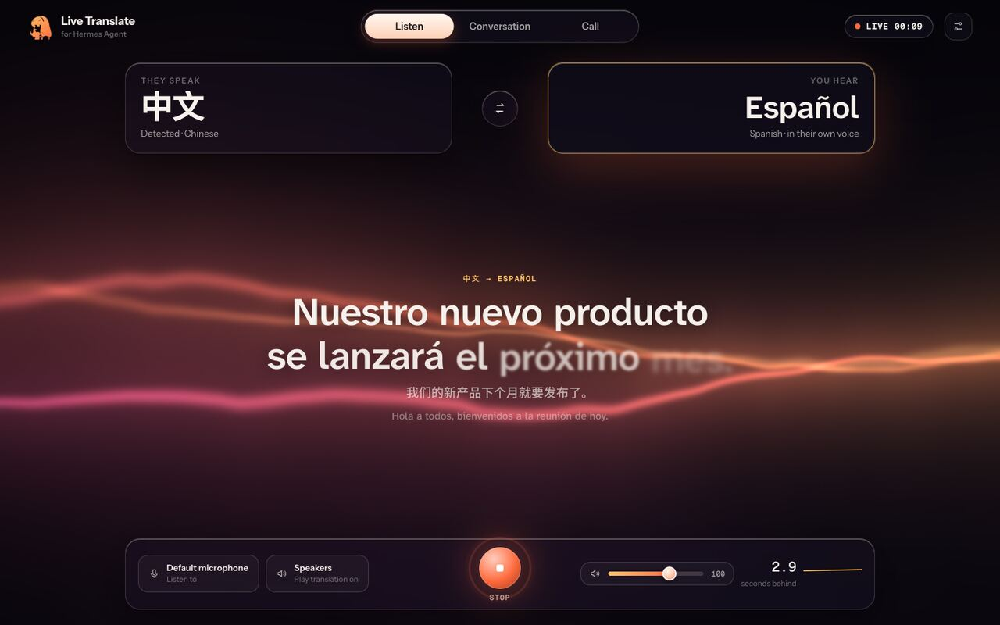
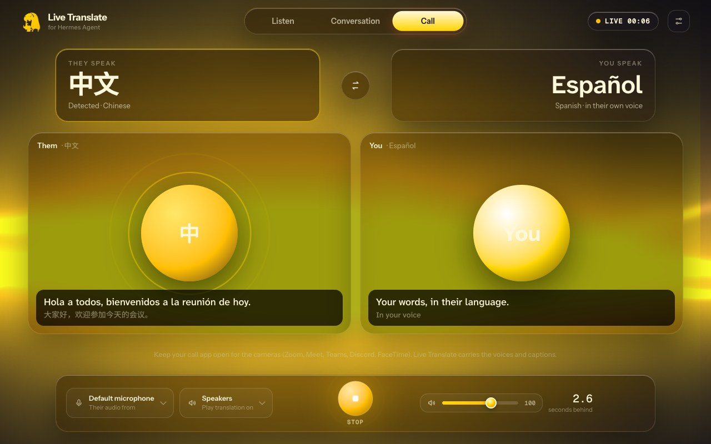
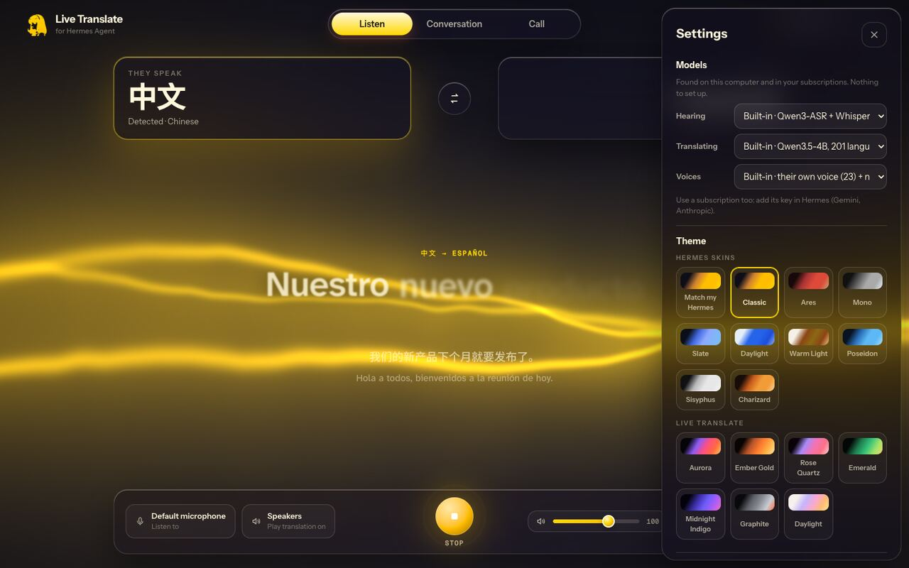
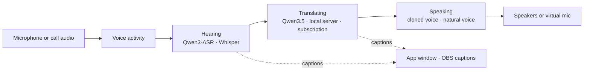

<div align="center">

# Live Translate

**Talk to anyone, in any language, live — in their own voice.**
A Hermes Agent plugin and desktop app. Runs on your computer.

[](LICENSE)
[](https://hermes-agent.nousresearch.com/docs/plugins)
[](#install)
[](#languages)
[](https://github.com/WestWaters/hermes-live-translator/actions/workflows/ci.yml)



</div>

Someone speaks Chinese. You hear Spanish, a couple of seconds later, in **their** voice. You answer in Spanish;
they hear Chinese, in **yours**. No interpreter, no subscription, nothing leaving your machine.

- **Hears ~100 languages** and works out which one is being spoken.
- **Translates between 201 languages and dialects.**
- **Keeps the speaker's voice** in 23 languages (cloned locally from five seconds of speech); the optional *Best*
  preset adds natural voices in 600+ more (non-commercial licence).
- **Both directions at once** for real conversations.
- **Built for real rooms:** echo cancellation, background voices ignored, several speakers each in their own
  voice and language, language switches followed. [How](docs/architecture.md#real-rooms-and-real-meetings)
- **Works with Zoom, Google Meet, Teams, Discord and OBS** as a microphone they can pick — their settings are never touched.
- **Your models, your choice:** built-in local models, anything running in Ollama / LM Studio / llama-server, or a subscription you already have.

## Contents
[Install](#install) · [Use it](#use-it) · [Models and subscriptions](#models-and-subscriptions) · [How it works](#how-it-works) ·
[Performance](#performance) · [Privacy and disclosures](#privacy-and-disclosures) · [Develop](#develop)

## Install

```bash
hermes plugins install https://github.com/WestWaters/hermes-live-translator
hermes translate setup     # once: builds the engine for your hardware and downloads its models (~9 GB)
```

Prefer clicking? Install the **Live Translate** desktop app from the [releases page](../../releases) and press
**Set up** — same result, with a progress bar. Builds for macOS (Apple Silicon, Intel), Windows (x64, ARM64) and
Linux (x64, ARM64 — including DGX Spark class machines).

| Your computer | Hearing | Translating | Voices |
|---|---|---|---|
| Apple Silicon Mac | Qwen3-ASR + Whisper (MLX) | Qwen3.5-4B (MLX) | Qwen3-TTS 1.7B · Chatterbox · OmniVoice |
| Windows / Linux + NVIDIA | faster-whisper | Qwen3.5-4B (llama.cpp, CUDA) | the same voices on PyTorch CUDA |
| Anything else | faster-whisper small (CPU) | Qwen3.5-4B (llama.cpp, CPU) | Kokoro natural voices (8 languages), the rest on the CPU |

## Use it

**Ask Hermes:** *"Translate this call into Spanish"*, *"Let me talk with my grandmother — she speaks Hindi"*.
The bundled [agent skill](skills/live-translate/SKILL.md) teaches Hermes the modes and devices.

**In chat:** `/translate Spanish` · `/translate English from Japanese` · `/translate status` · `/translate stop`

**In the app:** pick *They speak* and *You hear*, press the orb.

| | |
|---|---|
|  |  |
| **Call view** — each side subtitled in the other's language. | **Settings** — models found automatically; nine Hermes skins or *Match my Hermes*. |

**Calls and streams.** Choose the meeting's audio as *Listen to* (BlackHole on macOS, VB-CABLE on Windows,
a PipeWire monitor on Linux). For two-way, pick *Live Translate* as the microphone inside Zoom / Meet / Teams.
For streams, add the caption page (`http://127.0.0.1:7865/`) to OBS as a Browser Source.

## Models and subscriptions

Settings → **Models** lists what Live Translate found — nothing to configure:

| Group | What appears |
|---|---|
| On this computer | the built-in models for your hardware |
| Running on this computer | every model served by Ollama, LM Studio, llama-server or vLLM |
| Your subscriptions | OpenAI, Google Gemini, OpenRouter, Groq, Anthropic, ElevenLabs — when their key is set in Hermes — and the model Hermes itself uses |

Keys are read through Hermes's secret store and handed only to the part that needs them. Developers can route any
part anywhere: any [mlx-audio](https://github.com/Blaizzy/mlx-audio) voice, any OpenAI-compatible server, or any
program via the three-line [voice worker protocol](lt_engine/worker.py).

## How it works



Hearing, translating and speaking run in separate processes so they overlap. Each voice model runs in its own
environment (they pin incompatible libraries). If it falls behind a fast speaker it speaks up to 30% faster — same
pitch — and condenses, like a human interpreter. More in [docs/architecture.md](docs/architecture.md).

## Performance

Measured on the smallest Apple Silicon machine, an M4 Mac mini with 16 GB, on real recorded speakers:

| | |
|---|---|
| Behind the speaker | ≈3 s in conversation (≈10 s on dense, pause-free news reading) |
| Recognition | 0.15 s per phrase |
| Translation | ≈0.9 s per sentence |
| First audio, cloned voice | ≈0.5 s |
| Stop | ≈1 s |

## Privacy and disclosures

What Live Translate does on your computer, before you install it:

| | |
|---|---|
| **Microphone and speakers** | While translating it listens to the input you choose (microphone or a meeting's audio) and plays to the output you choose. It starts only when you ask; it never starts from a chat app (Telegram, ...) or a scheduled job unless you turn on *Allow starting from chat apps*. |
| **Voice cloning** | With *their own voice* on, a 5-second sample of each person speaking is used, on this computer only, to speak the translation in their voice. Samples stay on this computer, are never written to the session files, and the temporary copies voice workers use are deleted when the session stops. |
| **Transcripts** | Each session's captions (what was heard and its translation) are saved to `plugin-data/live-translate/sessions/*.jsonl` in your Hermes home. Delete them any time. |
| **Network** | None while translating with built-in or local models. If you pick a cloud model or voice (OpenAI, Gemini, OpenRouter, Groq, Anthropic, ElevenLabs), that service receives the session's text or audio with your key. *My Hermes model* sends text through Hermes to the model you already use. |
| **Keys** | Read only through Hermes's secret store, and handed only to the part that needs them. |
| **Downloads (setup only)** | Model weights from their official Hugging Face repos, into the standard Hugging Face cache (`~/.cache/huggingface`, or `HF_HOME`), 6-9 GB. Python packages from PyPI, PyTorch's index (Windows/Linux) and llama.cpp's prebuilt-wheel index (abetlen.github.io). uv from PyPI into the plugin's data folder if it is not installed. Nothing is downloaded while translating. |
| **Files** | The engine and its environments: `plugin-data/live-translate` in your Hermes home. |
| **Background processes** | The engine and its voice workers run while translating and stop on *Stop* or when the Hermes session that started them ends. A local server on `127.0.0.1:7865` (this computer only) serves the window and caption page; changes need a per-run token and a same-origin request; the endpoint for *My Hermes model* accepts only local processes holding that token. |
| **Safety** | Translation stops itself if the computer runs critically low on memory or disk. |
| **Model licences** | Recognition, translation and the default voices are Apache-2.0 / MIT. Echo cancellation is WebRTC (BSD) via LiveKit (Apache-2.0). On CPU-only machines the Kokoro voices read text with espeak-ng (GPL-3.0), installed from PyPI. The default voices are free for any use, including commercial. The optional *Best* preset adds OmniVoice (natural voices in 600+ languages), which is **CC-BY-NC-4.0**: personal and research use only. |

## Develop

```text
__init__.py          Hermes entry point (register only)
live_translate/      runs inside Hermes: session, setup, model detection, local server, state machine, CLI
lt_engine/           the engine (its own environment): audio, recognition, translation, voices, pipeline
  workers/           voice models in their own environments (Qwen3-TTS, Chatterbox, OmniVoice)
app/                 the window (served locally; also the desktop app's view)
tray/                Tauri desktop app: tray icon, themed window
skills/              the agent skill
requirements/        engine dependencies per platform
tests/               unit tests (pytest)
```

```bash
python -m pytest                    # unit tests
hermes plugins validate .           # the catalog's checks
python -m lt_engine --to es --file talk.wav --no-play --record out.wav   # the engine on a file
```

See [CONTRIBUTING.md](CONTRIBUTING.md). MIT licensed. Built by WestWaters for the Hermes Agent plugin hackathon;
not affiliated with or endorsed by Nous Research.
